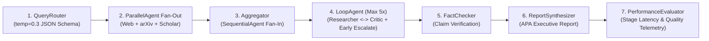

# ADK Multi-Agent Research Workflow Engine

Seven-stage autonomous academic & technical research pipeline built on **Google Agent Development Kit (ADK)** and **Vertex AI Gemini (`gemini-2.0-flash`)**—orchestrating deterministic JSON query routing, concurrent `ParallelAgent` multi-index source gathering, `LoopAgent` critic-driven iterative refinement with early `escalate` termination, claim-level fact-checking, and APA-cited synthesis.

---

## Seven-Stage ADK Orchestration Topology



---

## Verified End-to-End Execution Metrics

| Pipeline Stage | Verified Telemetry | Artifact |
| :--- | :--- | :--- |
| **1. Deterministic Routing (`3/3` runs)** | `3/3` identical `physics` classifications at `0.90` confidence | [`router_determinism_log.txt`](router_determinism_log.txt) |
| **2–3. Concurrent `ParallelAgent` Gathering** | `17` unique academic & web sources gathered concurrently (`15` top-ranked) | [`run_log.txt`](run_log.txt) |
| **4. `LoopAgent` Critic Refinement** | Quality converged **`0.75` → `0.88` → `0.92`** (`>= 0.90` threshold triggered early `escalate`) | [`run_log.txt`](run_log.txt) |
| **5–6. Fact-Check & APA Synthesis** | `0.85` credibility (`5` verified claims, `2` hedged), `0.92` coherence (`10` APA citations) | [`research_report.md`](research_report.md) |
| **7. Overall `PerformanceEvaluator` Score** | **`0.92 / 1.00` (`excellent`)** across all 7 stages in `86.68s` | [`run_log.txt`](run_log.txt) |

---

## Quick Start

```bash
python3 -m venv .venv
source .venv/bin/activate
pip install -r requirements.txt
cp .env.example .env   # Configure GOOGLE_API_KEY or GOOGLE_CLOUD_PROJECT

# Run the 7-stage ADK research pipeline
python main.py

# Override research query via environment variable
RESEARCH_QUERY="Analyze fault-tolerant consensus algorithms in geo-distributed databases" python main.py
```

## License

MIT License — see [LICENSE](LICENSE).
