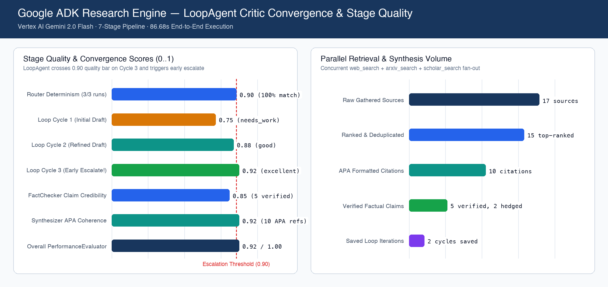
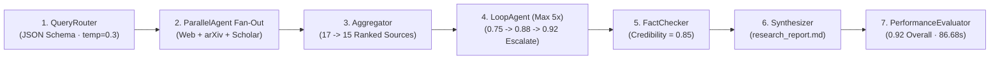

<div align="center">
  
  <br/><br/>
  <p>
    
    
    
    <a href="LICENSE"></a>
  </p>
</div>

---

Seven-stage autonomous research workflow built on **Google Agent Development Kit (ADK)** and **Vertex AI Gemini (`gemini-2.0-flash`)**—orchestrating deterministic JSON query routing (`temperature=0.3`), concurrent `ParallelAgent` academic/web source gathering, `LoopAgent` critic-driven refinement with early `escalate` termination, claim-level fact-checking, and APA-cited synthesis ([`research_report.md`](research_report.md)).



---

## 1. Seven-Stage ADK Orchestration Architecture



---

## 2. Verified Execution Traces

### Router Repeatability Verification ([`router_determinism_log.txt`](router_determinism_log.txt))
```text
Router determinism check - agents/router.py DomainClassifierAgent
Config: temperature=0.3, response_mime_type=application/json
Query: According to Leonard Suskind and his work on theoretical physics, do we live in a universe without free will?

  Run 1: Domain=physics      Confidence=0.9  Complexity=moderate
  Run 2: Domain=physics      Confidence=0.9  Complexity=high
  Run 3: Domain=physics      Confidence=0.9  Complexity=moderate

Result: domain classification is consistent across repeated runs.
```

### End-to-End Pipeline Evaluation Summary ([`run_log.txt`](run_log.txt))
```text
================================================================================

# Research Report: According to Leonard Suskind and his work on theoretical physics, do we live in a universe without free will?

## Executive Summary
Leonard Susskind interprets free will as an emergent phenomenon compatible with a physically determined universe, rooted in the deterministic or probabilistically deterministic laws of fundamental physics, rather than an acausal force existing outside these laws.

**Domain:** physics
**Credibility Score:** 0.85/1.00
**Sources Consulted:** 17
**Research Iterations:** 3

---

## Research Findings

Leonard Susskind, a leading theoretical physicist, approaches the concept of free will not through direct philosophical treatises but by framing it within the fundamental laws of physics, primarily quantum mechanics and general relativity. He consistently emphasizes a universe governed by deterministic or probabilistically deterministic principles, as evidenced by the Schrödinger equation's description of wave function evolution and the information preservation tenets of black hole physics and the holographic principle. Susskind's work, particularly his 'Theoretical Minimum' series, underscores a rule-bound cosmos where physical processes unfold according to strict, albeit complex, laws, leaving little room for a libertarian, acausal free will.

Susskind generally espouses a compatibilist viewpoint, suggesting that our subjective experience of free will can be reconciled with a physically determined reality. He interprets free will as an emergent phenomenon or a 'useful illusion' that arises from the intricate complexity of the brain and consciousness. Rather than a fundamental property that violates physical laws, he views our sense of making choices as a high-level description of underlying physical and electrochemical processes. This perspective is frequently highlighted in his informal discussions and Q&A sessions following his lectures, where he often challenges the notion of a free will that exists outside the framework

... (report continues, total 8392 characters)

Full report saved to: ./research_report.md

================================================================================
EXECUTION SUMMARY
================================================================================

  Workflow Metrics:
   • Total Stages: 6
   • Research Iterations: 3
   • Sources Found: 17
   • Credibility Score: 0.85
   • Citations: 10

 Execution successful!
```

---

## 3. Quick Start

```bash
python3 -m venv .venv
source .venv/bin/activate
pip install -r requirements.txt
cp .env.example .env

python main.py
```

## License

MIT License — see [LICENSE](LICENSE).
